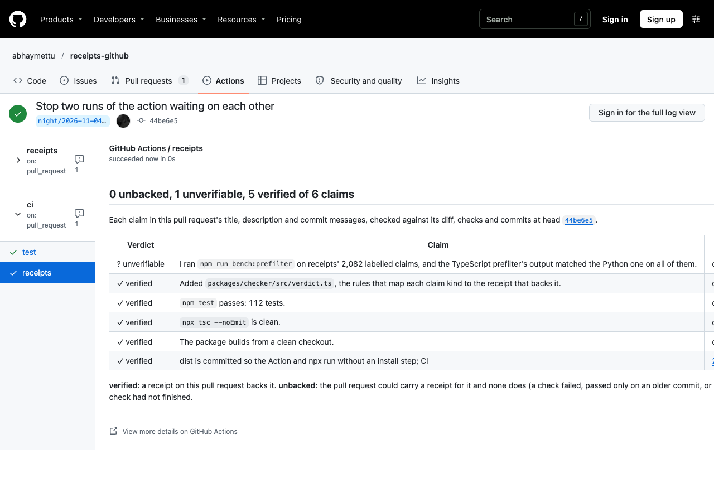

# receipts-github

**Your coding agent's pull request says the tests pass. receipts-github checks whether anything on the pull request
shows it.**

It reads the claims in a pull request's title, description and commit messages ("tests pass", "updated
`src/config.ts`", "committed as `a41c9e2`"). It checks each one against the receipts the pull request carries: the
diff, the check runs and statuses, the commands its Actions jobs ran, and its commits. Each claim comes back
**verified**, **unbacked** or **unverifiable**, in one check run, with a link to the receipt that decided it.



It is the pull request side of [receipts](https://github.com/abhaymettu/receipts), which checks the same claims
against an agent's own session log.

## What it caught

Devin opened [Open-MBEE/OpenSysML#1908](https://github.com/Open-MBEE/OpenSysML/pull/1908). Its checklist ticks
"`make test` and `make lint` pass locally". CI ran on the commit before the head, and nothing ran on the head:

```
$ npx github:abhaymettu/receipts-github https://github.com/Open-MBEE/OpenSysML/pull/1908
body           UNBACKED      test_pass       [x] `make test` and `make lint` pass locally
               -> tests last ran on 63c4dc3, 1 commit(s) before the head
body           UNVERIFIABLE  lint_pass       [x] `make test` and `make lint` pass locally
               -> no check says it runs a linter, and `SysON plugin`, `Xpect oracle reproduces its baseline`, `Conformance suite` and 8 more do not say what they ran
body           VERIFIED      file_change     `go test -C tools ./census/notation`: extractor tests over a committed excerpt of the rendered text…
               -> the diff touches `testdata/sysml-8.2.3-productions.txt`
https://github.com/Open-MBEE/OpenSysML/pull/1908 @ eb8e5c7: 1 unbacked, 2 unverifiable, 3 verified of 6 claims
```

(Three verified and unverifiable rows are cut here.) A Codex pull request,
[can1357/oh-my-pi#15391](https://github.com/can1357/oh-my-pi/pull/15391), says three test suites pass, and no check
ran on any of its 12 commits. That one comes back `unbacked: no check ran on this pull request`.

This repository runs the App on its own pull requests. On [#2](https://github.com/abhaymettu/receipts-github/pull/2),
the pull request that added the App, its verdict on the first push caught me: the description said `npm test` passes, and CI
had failed on a test that still read the workflow file the same pull request removed. After the fix,
[the App's check run](https://github.com/abhaymettu/receipts-github/runs/126427124575) verified five claims against
the `test` job, the diff and the commits. The sixth, "I deployed the Worker", is unverifiable, and rightly: no pull
request can carry that receipt. The picture above is the action's run on [#1](https://github.com/abhaymettu/receipts-github/pull/1).

## Install

[](https://github.com/apps/receipts-github/installations/new)

Pick the repositories, and the `receipts` check appears on their next pull request. There is no workflow file and no
token to set. The App reads code, pull requests, Actions logs and commit statuses, and writes only check runs.

It checks a pull request when it opens, when its description is edited and on every push. While the pull request's
other checks are still running, the check stays in progress. When they finish, it posts the verdicts. Re-running the
check from the Checks tab reads everything again.

### Or run it as an Action

If you would rather keep it inside your own Actions minutes, run this in your repository:

```bash
npx github:abhaymettu/receipts-github init
```

It writes `.github/workflows/receipts.yml`. Commit it, and the check appears on your next pull request:

```yaml
name: receipts
on:
  pull_request:
    types: [opened, edited, synchronize, reopened]
permissions:
  checks: write
  contents: read
  pull-requests: read
  actions: read
  statuses: read
jobs:
  read-claims:
    runs-on: ubuntu-latest
    steps:
      - uses: abhaymettu/receipts-github@v0.1.0
```

To try it on any public pull request without installing anything:

```bash
npx github:abhaymettu/receipts-github https://github.com/OWNER/REPO/pull/123
npx github:abhaymettu/receipts-github OWNER/REPO#123 --json
```

The CLI uses `GITHUB_TOKEN` or your `gh` login, and works without either at GitHub's low anonymous rate limit. It
exits 1 when a claim is unbacked, unless you pass `--fail-on never`.

| Action input | Default | What it does |
|---|---|---|
| `fail-on` | `unbacked` | `unbacked` fails the check run when a claim has no receipt. `never` reports without failing. |
| `wait-minutes` | `10` | How long to wait for the pull request's other checks to finish before judging. |
| `check-name` | `receipts` | The name of the check run it posts. |
| `token` | `github.token` | Reads the pull request and creates the check run. |

## What counts as a receipt

| Claim | Receipt | Unbacked when |
|---|---|---|
| tests pass, the build is clean, lint and types pass | A check on the head commit that runs tests (or builds, lints, type-checks). It counts by its name, by an Actions step that ran such a command, or by running the command the claim names. | It failed on the head commit (contradicted), passed only on an older commit (stale), or no such check ran (missing). |
| it works, the bug is fixed | A passing test check on the head commit. Changed test files are listed beside it. | As above. A build or lint check alone does not exercise behaviour. |
| updated `src/config.ts` | The file is in the diff, by path, suffix or rename. A file the diff adds a line naming also counts. | The diff does not touch it. |
| committed as `a41c9e2`, pushed | The sha prefixes one of the pull request's commits. | The commit is not in the pull request. |
| deployed, installed, I ran the migration, I tested it by hand | A check on the head commit that ran it. | Never. Without that check these are **unverifiable**: nothing a pull request carries could show them. |

A check that names no kind of work and logs nothing readable (an external CI status, say) makes a claim
unverifiable, not unbacked. Runs cancelled by a newer push count as skipped, not failed. Neither the App nor the
action judges its own check. [`CONTRACT.md`](CONTRACT.md) has every rule, every API field it reads, and the protocol for measuring
it.

## How well it reads claims

The claim prefilter is receipts' regex layer, ported to TypeScript. On receipts' 2,082 hand-labelled claims, the
port's output is identical to the Python original on every one. The same holds on 400 full reports, 4,373 session
reports and 20,000 generated strings.

Against the labels themselves, the regex fires on 19.4% of labelled claims (95% CI 17.7 to 21.1). When it fires, it
names the labelled category 69.0% of the time (64.3 to 73.3). Most claims are phrased in ways no pattern anticipates,
which is receipts' own finding. A model extractor for the claims the regex misses is the next piece. The verdict
rules get their own precision and recall from 200 frozen pull requests, labelled blind by two labellers, as
[`CONTRACT.md`](CONTRACT.md) preregisters.

```bash
npm run bench:prefilter    # needs receipts' private labelled set; writes bench/results/prefilter.json
```

## How it is built

- `packages/checker` is pure. `parseReceipts` turns GitHub's REST responses into one `PullRequest` at the boundary,
  and check runs and commit statuses become one `Check` type. `judge(claim, pr)` is a total function over the claim
  kinds, with an exhaustive switch.
- `packages/github` holds the I/O: a small REST client over `fetch`, the action, the CLI and the App. The wait-for-CI
  decision is a pure function with its own tests.
- The App is a Cloudflare Worker (`src/bin/worker.ts`). It checks each webhook's signature, signs the App's JWT with
  WebCrypto, and writes one check run per head commit, updated in place. Reading five commits and ten job logs keeps a
  check near 30 requests, inside a free Worker's 50.
- One esbuild bundle per entry point in `dist/` serves the action, `npx` and the Worker. CI rebuilds them and fails if
  a committed copy drifts.
- The only runtime dependency is zod, and it is bundled. Permissions are read-only plus `checks: write`. On a fork
  pull request, where the token cannot write checks, the verdicts go to the job summary instead.
- The tests include ten real agent pull requests (Copilot, Devin, Jules, Cursor, Claude Code, Codex) recorded as
  fixtures, with their verdicts checked by hand against the pull requests on GitHub
  ([list](packages/checker/test/fixtures/README.md)).

```bash
npm ci
npm test               # vitest
npx tsc --noEmit       # strict, no any
npm run build          # checker package, then dist/
```

To run your own copy of the App: register a GitHub App with the permissions above and the `pull_request`,
`check_suite` and `check_run` events, point its webhook at `https://<your worker>/webhook`, set `APP_ID` in
`wrangler.toml`, and store the key and webhook secret as Worker secrets. GitHub hands out a PKCS#1 key, and WebCrypto
wants PKCS#8:

```bash
openssl pkcs8 -topk8 -nocrypt -in app.private-key.pem | npx wrangler@4.157.0 secret put PRIVATE_KEY
npx wrangler@4.157.0 secret put WEBHOOK_SECRET
npm run build && npx wrangler@4.157.0 deploy
```

## License

MIT
